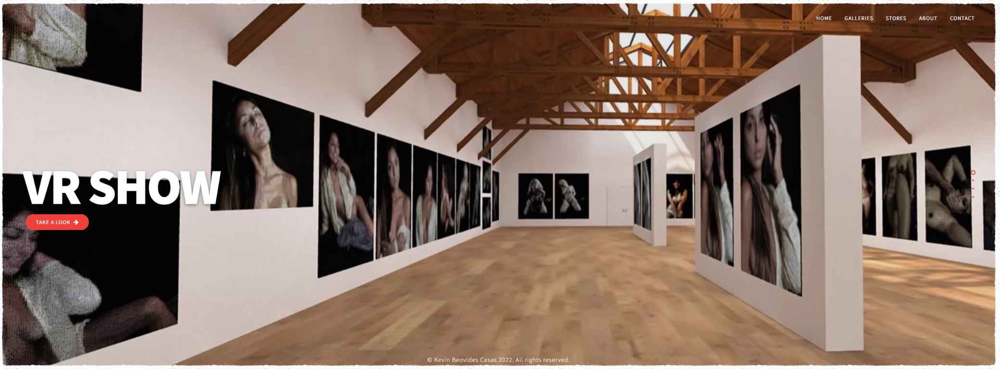

# El Diletante

[El Diletante](https://eldiletante.com/) is the online portfolio of visual artist and writer **Kevin Beovides Casas**. The site presents a body of digital artwork made from photographs and processed with a custom application that extends traditional ASCII art into a more pictorial form.

## Artistic approach

The project explores the relationship between imitation and representation, bringing together photography, literature, code, and digital image-making. Its work is concerned with the underlying communicational logic of digital technologies and the code beneath digital images. The resulting images invite viewers to move between abstraction and recognizable form: stepping back restores the closeness of the image.

## Galleries

- **[VR Show](https://oncyber.io/kevinbcasas)** — an immersive online exhibition.
- **[Itinerant](https://eldiletante.com/itinerant.html)** — a collection of digital and photographic works.
- **[Nudes](https://eldiletante.com/nudes.html)** — figurative and nude studies.
- **[Visual Poems](https://eldiletante.com/rolando.html)** — a collaboration with Rolando Santini.

## Related work

### The Digital Dilettante

[The Digital Dilettante](https://eldiletante.com/edd.html) was an online gallery and new-media art project founded by Kevin at the University of Arts of Cuba (ISA). Active from 2006 to 2011, it featured work by more than twenty artists, supported experimentation with internet-based art, published critical writing, and helped students develop new-media artworks and theses. The project also organized workshops on digital art and electronic poetry.

### The application

The artwork is produced with a special application designed and programmed by the artist. Its ASCII-art process uses newer code libraries to create images that are more pictorial than earlier text-art works.

### *Outlooks on Digital Art*

The [book page](https://eldiletante.com/book.html) describes *Outlooks on Digital Art* (*Perspectivas del Arte Digital*, 2020), a three-author collection about contemporary digital art. Kevin’s chapter summarizes his master’s research and examines artistic practices on the internet through the example of The Digital Dilettante.

## About the artist

Kevin Beovides Casas works across visual arts, literature, and technology. His work has appeared in exhibitions including *Ojalá!* in Berlin (2015) and [*Hope* at ESMoA](https://esmoa.org/experience/hope/) in Los Angeles (2017). He has taught at the University of Arts of Cuba, the University of Havana, and Miami Dade College, and has spoken at events including Princeton University’s *Beyond the Hyphen* conference.

His education includes:

- B.A. in Philosophy, University of Havana (2004)
- M.A. in Art History, University of Havana (2011)
- A.S. in Computer Programming and Analysis, Miami Dade College (2019)

More background is available on the [artist page](https://eldiletante.com/artist.html), with additional profiles on [LinkedIn](https://www.linkedin.com/in/beovideskevin) and [GitHub](https://github.com/beovideskevin).

## Collect and follow

The site links to the artist’s work and editions on:

- [Etsy](https://kevinbcasas.etsy.com)
- [OpenSea](https://opensea.io/BeovidesKevin)
- [Foundation](https://foundation.app/@beovideskevin)
- [Rarible](https://rarible.com/kevinbcasas)
- [Objkt](https://objkt.com/profile/tz2Uhk9UgRqf1ka6kqJU518WvWtDu5C2WzfS/created)

For questions, collaborations, or ideas, use the [contact form](https://eldiletante.com/contact.html).
